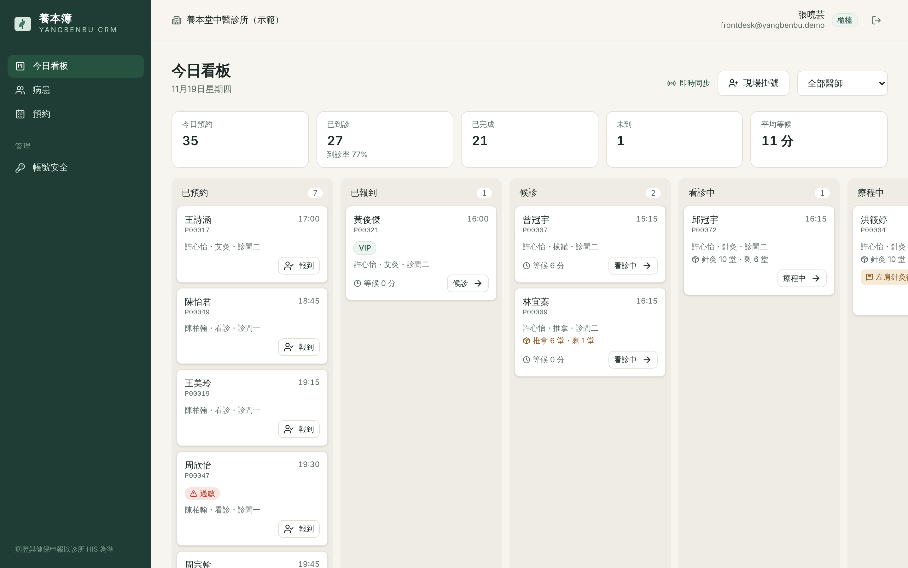
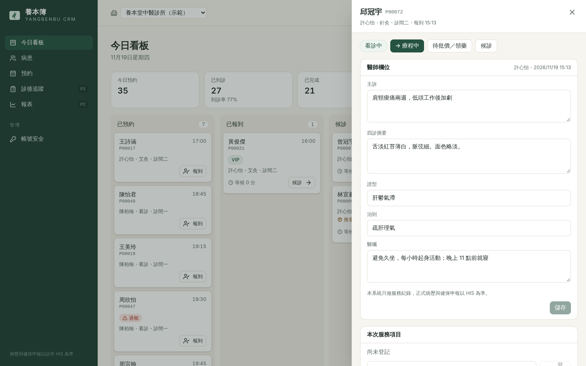
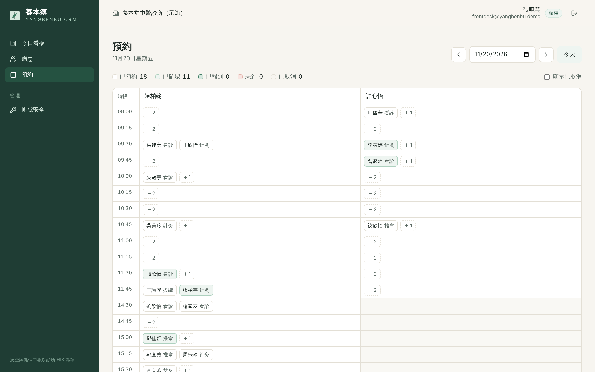
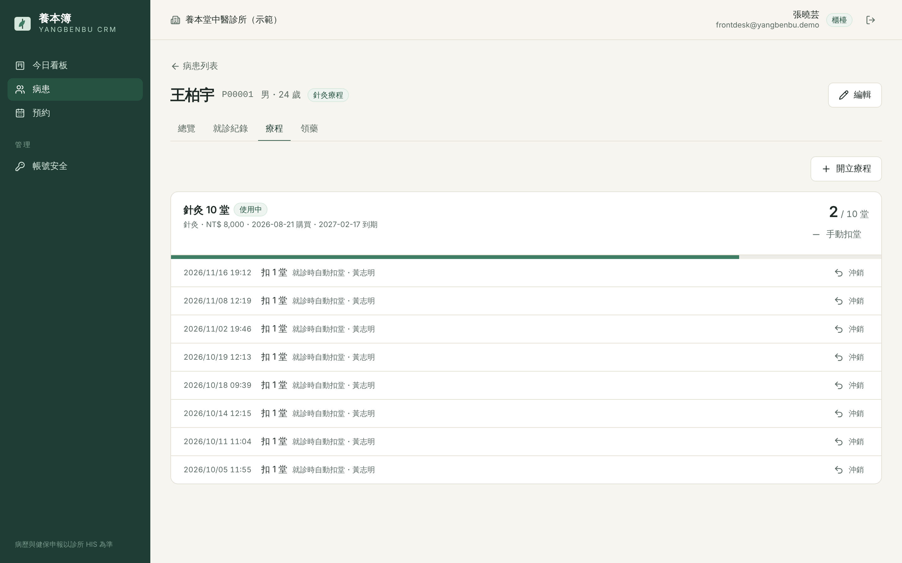
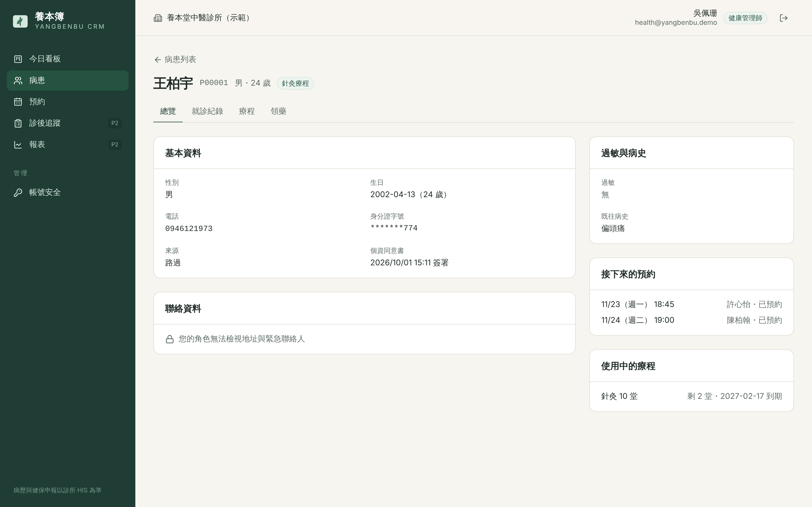
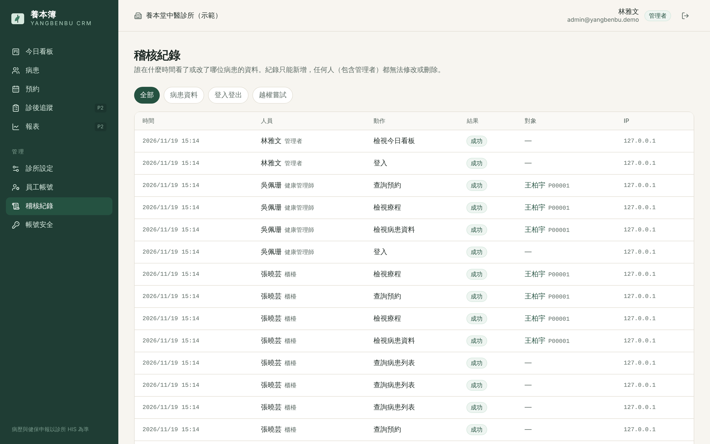

# 養本簿 Yangbenbu CRM

以中醫診療與長期健康管理為核心的診所 CRM 與健康管理系統。

定位為 **HIS 之上的 CRM／健康管理層**：健保卡、申報、處方交給既有 HIS；養本簿負責今日看板、跨職務交接、預約、療程堂數、領藥追蹤、體質問卷、調理方案、診後追蹤與 LINE 互動。



| 就診單：醫師欄位、服務項目自動扣堂、交接備註     | 預約：依醫師分欄，點空位直接預約                     |
| ------------------------------------------------ | ---------------------------------------------------- |
|       |            |
| **療程：剩餘堂數由扣堂紀錄加總，更正以沖銷處理** | **同一位病患，健康管理師看不到地址**                 |
|    |  |
| **稽核紀錄：誰、何時、看了或改了哪位病患**       | **登入頁（示範模式）**                               |
|           |                   |

> 畫面中所有人名、診所、身分證字號皆為虛構的示範資料。

## 開發進度

| 階段        | 內容                                                                       | 狀態    |
| ----------- | -------------------------------------------------------------------------- | ------- |
| **Phase 0** | Monorepo、認證與兩步驟驗證、多租戶隔離、角色權限、稽核紀錄、CI             | ✅ 完成 |
| **Phase 1** | 病患管理、排班與預約、今日看板與就診單、療程扣堂、領藥紀錄、Docker、示範站 | ✅ 完成 |
| Phase 2     | 問卷引擎（體質問卷）、健康數據、調理方案、診後追蹤、報表                   | 規劃中  |
| Phase 3     | LINE LIFF 病患端「我的養本簿」、LINE 推播                                  | 規劃中  |
| Phase 4     | FHIR（TW Core）API 與匯出、HIS 匯入                                        | 規劃中  |

## 技術棧

| 層級     | 技術                                                                           |
| -------- | ------------------------------------------------------------------------------ |
| 前端     | Next.js 16（App Router）· React 19 · Tailwind CSS 4 · TanStack Query · dnd-kit |
| 後端     | NestJS 11（Fastify）· Prisma 6 · PostgreSQL 16                                 |
| 即時同步 | PostgreSQL `LISTEN/NOTIFY` → Server-Sent Events                                |
| 背景工作 | pg-boss（以 PostgreSQL 當佇列，不需 Redis）                                    |
| 共用     | TypeScript · Zod（前後端共用驗證規則、型別、權限表、就診狀態機）               |
| 工具     | pnpm workspaces · Turborepo · Vitest · Playwright · Docker · GitHub Actions    |

## 功能

**今日看板**：已預約 → 已報到 → 候診 → 看診中 → 療程中 → 待批價／領藥 → 已完成。拖曳或按「下一步」推進，不合法的移動（例如跳過看診）直接擋下。卡片顯示等候分鐘數、過敏／初診／VIP、可抵用療程的剩餘堂數、交接備註。櫃檯、診間、治療室多台裝置**即時同步**，兩台同時拖同一張卡片時，後到的會收到提示而不是互相覆蓋。

**就診單**：醫師填寫主訴、四診摘要、證型、治則、醫囑（加密儲存）；登記服務項目時，病患有可抵用的療程就**自動扣堂**，移除時自動退回；交接備註可指定給某個職務。

**預約**：依醫師排班切出時段，每時段有名額上限；確認、改期、取消、未到、報到。休診日設定後當天不開放預約。

**病患**：新增與編輯（前後端共用同一份驗證規則）、標籤篩選、360° 頁面（總覽、就診紀錄、療程、領藥、稽核）。

**療程與領藥**：開立療程（購買當下的堂數與價格為快照）、手動扣堂（需冪等鍵）、沖銷；領藥紀錄計算下次可領日。

**診所設定**：醫師每週排班、休診日、服務項目、療程方案。

## 設計重點

**多租戶隔離做在資料庫層。** 每個查詢都在設定了 `app.clinic_id` 的交易中執行，PostgreSQL Row-Level Security 只讓它看到該診所的資料。外鍵本身不受 RLS 限制，所以另有 trigger 確認「預約指向的病患」屬於同一家診所。

**同一個 API，不同角色拿到不同欄位。** 櫃檯負責預約與扣堂，但看不到醫師欄位；健康管理師看得到病史，但看不到地址；完整身分證字號要另外按「查看」並留下紀錄。

**帳一定對得起來。** 剩餘堂數 = 總堂數 − 扣堂紀錄加總，不另存計數。扣堂紀錄只能新增（trigger 擋下修改與刪除），更正以沖銷處理。扣堂前鎖住療程、手動扣堂需要冪等鍵；預約以 advisory lock 鎖住「醫師 + 時段」。整合測試會同時送出 5 個請求搶 2 個名額，確認剛好成功 2 個。

**稽核紀錄無法竄改。** 讀取病患資料與寫入稽核在同一個交易，稽核寫不進去就不回傳資料。修改只記錄「改了哪些欄位」，不記錄內容。

**認證。** Argon2id 密碼雜湊、連續失敗鎖定、TOTP 兩步驟驗證（防重放）、Session 閒置逾時、`httpOnly` + `SameSite=Strict` cookie、Origin 檢查防 CSRF。

詳見 [03 安全設計](docs/03-安全設計.md)。

## 快速開始

需要 Node.js 22+、pnpm 10、Docker（或自行安裝的 PostgreSQL 16）。

```bash
cp .env.example .env
```

產生兩把金鑰，分別填入 `.env` 的 `FIELD_ENCRYPTION_KEY` 與 `FIELD_HASH_KEY`：

```bash
node -e "console.log(require('crypto').randomBytes(32).toString('base64'))"
```

啟動資料庫、安裝套件、建立資料表與示範資料：

```bash
docker compose up -d
```

```bash
pnpm install
```

```bash
pnpm db:deploy && pnpm db:seed
```

啟動開發伺服器（前端 3100、API 4100、Worker）：

```bash
pnpm dev
```

開啟 http://localhost:3100 。示範資料包含過去 45 天的就診紀錄與今天起一週的預約；`DEMO_MODE=true` 時 Worker 每 10 分鐘依現在時間推進今天的示範病患，看板隨時都有正在進行的就診。

只想看成果、不想安裝 Node.js：

```bash
docker compose --profile demo up --build
```

### Port 被佔用時

預設使用 3100（前端）與 4100（API），刻意避開許多開發工具常用的 3000／4000。如果仍被佔用，可以先查是哪個程式：

```bash
# macOS / Linux
lsof -i :3100
```

```powershell
# Windows
netstat -ano | findstr :3100
```

前端改用其他 port：

```bash
pnpm --filter @yangbenbu/web dev --port 3200
```

API 改 port：在 `.env` 修改 `API_PORT`，並把 `API_URL` 改成相同的 port。

### 示範帳號

密碼皆為 `Demo1234!`。

| 角色           | Email                       | 用來展示                               |
| -------------- | --------------------------- | -------------------------------------- |
| 管理者         | admin@yangbenbu.demo        | 診所設定、稽核紀錄、員工帳號           |
| 醫師           | doctor@yangbenbu.demo       | 填寫醫師欄位；同時屬於兩家診所，可切換 |
| 醫師           | doctor2@yangbenbu.demo      | 第二位醫師（預約行事曆的第二欄）       |
| 櫃檯           | frontdesk@yangbenbu.demo    | 預約、報到、扣堂；看不到醫師欄位       |
| 診務人員       | assistant@yangbenbu.demo    | 推進看板、登記服務項目；不能編輯病患   |
| 健康管理師     | health@yangbenbu.demo       | 看板唯讀；看不到地址與完整身分證字號   |
| 管理者（青禾） | admin.qinghe@yangbenbu.demo | 另一家診所，看不到養本堂的任何資料     |

建議同時用兩個瀏覽器（或一般視窗 + 無痕視窗）分別登入櫃檯與診務，在其中一個拖曳看板卡片，另一個會即時更新。

## 部署

一個 `Dockerfile`，`api`／`worker`／`web` 三個正式環境目標，加上單一容器的 `demo` 目標（前端 + API + Worker，啟動時自動套用 migration 與示範資料）。公開示範站可用 `render.yaml` 一鍵部署到 Render，資料庫用 Neon，都有免費方案。

詳見 [04 部署](docs/04-部署.md)。

## 指令

| 指令                           | 說明                         |
| ------------------------------ | ---------------------------- |
| `pnpm dev`                     | 啟動所有服務（watch 模式）   |
| `pnpm build`                   | 建置全部                     |
| `pnpm lint` / `pnpm typecheck` | 程式碼檢查                   |
| `pnpm test`                    | 執行所有測試                 |
| `pnpm db:migrate`              | 修改 schema 後產生 migration |
| `pnpm db:deploy`               | 套用 migration               |
| `pnpm db:seed`                 | 載入示範資料（可重複執行）   |

## 測試

共 102 個測試。API 整合測試（80 個）使用**真實的 PostgreSQL**（不是 mock），因為 RLS、trigger、列鎖這類防護只有在真資料庫上才驗證得了。每次測試會在 `TEST_DATABASE_URL` 指向的伺服器上建立一個名稱唯一的暫時資料庫，測完刪除，不會動到任何既有資料庫。

涵蓋：

- 登入、帳號鎖定、帳號列舉防護、Session 逾時與登出、TOTP 與防重放、CSRF Origin 檢查
- RLS 讀寫隔離、跨診所存取回應 404、預設拒絕、跨診所參照被 trigger 擋下
- 角色權限、欄位層級權限（同一位病患不同角色看到的欄位）、越權嘗試留下紀錄
- 身分證、病史、醫師欄位在資料庫中為密文；稽核只記錄修改的欄位名稱
- 預約：只能約門診時段、**同時 5 人搶 2 個名額剛好成功 2 個**、病患重複預約、休診日、改期
- 就診狀態機：不合法轉換、**兩台裝置同時拖曳**、狀態紀錄不可修改、看板即時通知只送給同一家診所
- 療程：登記服務自動扣堂、移除自動沖銷、冪等鍵、**同時扣最後兩堂剛好成功兩次**、扣堂紀錄不可修改
- 領藥、作廢；診所設定（排班不可重疊）

CI 另外會從零產生完整示範資料，並建置全部 Docker 映像。

## 專案結構

```
apps/
  web/        Next.js 前端（診所後台；Phase 3 加入 LINE LIFF 病患端）
  api/        NestJS 後端（REST API，/api/v1）
  worker/     背景工作（pg-boss）：未到標記、Session 清理、示範資料推進
packages/
  shared/     角色、權限矩陣、就診狀態機、Zod schema、時區工具（前後端共用）
  db/         Prisma schema、migration（含 RLS 與 trigger）、欄位加密、示範資料產生器
scripts/      資料庫角色初始化、示範站啟動程序
docs/         規劃與設計文件
Dockerfile    api／worker／web／demo 四個建置目標
render.yaml   公開示範站（Render Blueprint）
```

## 文件

- [01 技術選型研究與架構建議](docs/01-技術選型研究.md)
- [02 功能規劃與系統架構](docs/02-功能規劃與系統架構.md)
- [03 安全設計](docs/03-安全設計.md)
- [04 部署](docs/04-部署.md)
