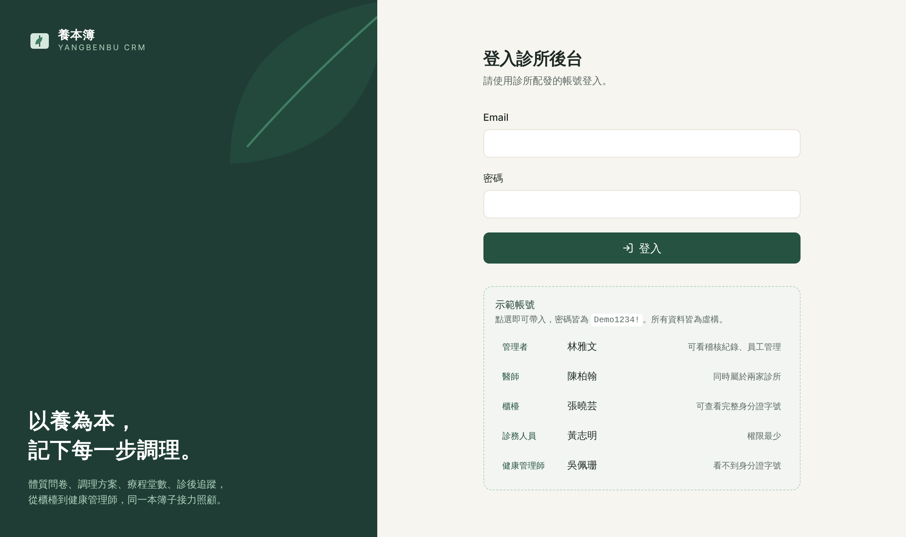
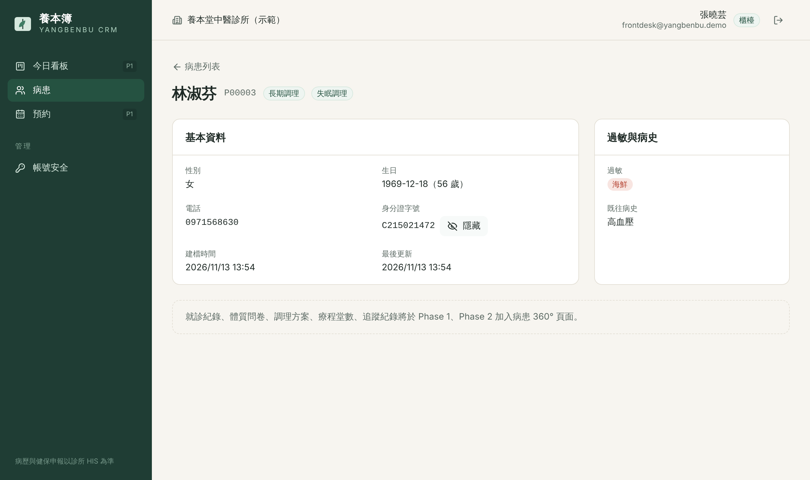
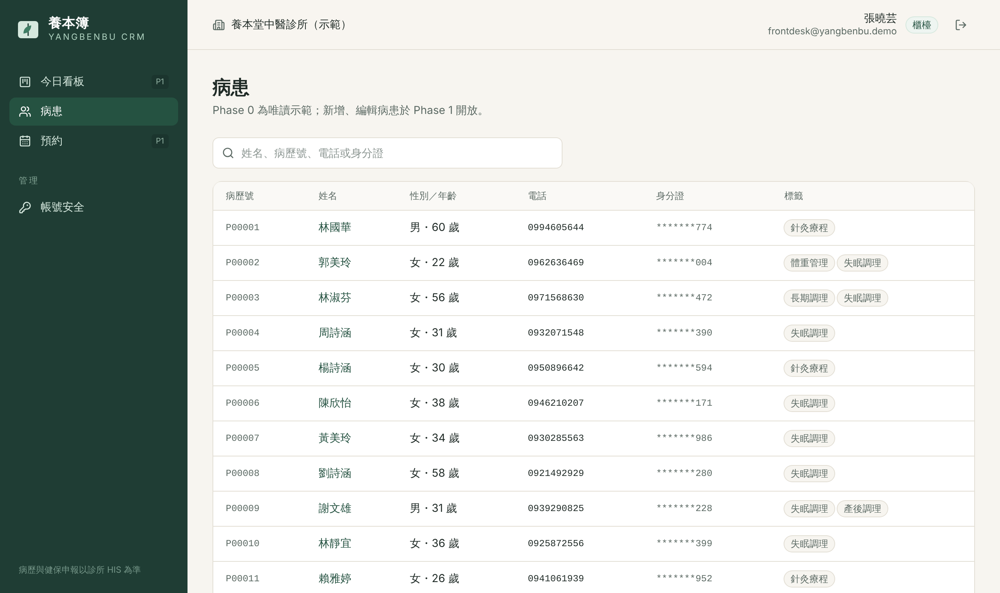

# 養本簿 Yangbenbu CRM

以中醫診療與長期健康管理為核心的診所 CRM 與健康管理系統。

定位為 **HIS 之上的 CRM／健康管理層**：健保卡、申報、處方交給既有 HIS；養本簿負責體質問卷、調理方案、療程堂數、今日看板、跨職務交接、診後追蹤與 LINE 互動。

| 登入（示範模式） | 病患詳情：身分證字號需另外查看並留下紀錄 |
|---|---|
|  |  |
| **病患列表** | **稽核紀錄：誰、何時、看了哪位病患** |
|  |  |

> 畫面中所有人名、診所、身分證字號皆為虛構的示範資料。

## 開發進度

| 階段 | 內容 | 狀態 |
|---|---|---|
| **Phase 0** | Monorepo、認證與兩步驟驗證、多租戶隔離、角色權限、稽核紀錄、CI | ✅ 完成 |
| Phase 1 | 病患管理、預約、就診單與今日看板、療程扣堂、領藥紀錄 | 規劃中 |
| Phase 2 | 問卷引擎（體質問卷）、健康數據、調理方案、診後追蹤、報表 | 規劃中 |
| Phase 3 | LINE LIFF 病患端「我的養本簿」、LINE 推播 | 規劃中 |
| Phase 4 | FHIR（TW Core）API 與匯出、HIS 匯入 | 規劃中 |

## 技術棧

| 層級 | 技術 |
|---|---|
| 前端 | Next.js 16（App Router）· React 19 · Tailwind CSS 4 · TanStack Query |
| 後端 | NestJS 11（Fastify）· Prisma 6 · PostgreSQL 16 |
| 背景工作 | pg-boss（以 PostgreSQL 當佇列，不需 Redis） |
| 共用 | TypeScript · Zod（前後端共用驗證規則與型別） |
| 工具 | pnpm workspaces · Turborepo · Vitest · Playwright · GitHub Actions |

## Phase 0 重點

**多租戶隔離做在資料庫層。** 每個查詢都在設定了 `app.clinic_id` 的交易中執行，PostgreSQL Row-Level Security 只讓它看到該診所的資料。即使程式碼忘了加 `where clinicId`，也拿不到別家診所的病患；沒設定診所時一筆都看不到（預設拒絕）。

**稽核紀錄無法竄改。** 讀取病患資料與寫入稽核在同一個交易，稽核寫不進去就不回傳資料。資料表沒有 UPDATE／DELETE 政策，另有 trigger 阻擋修改、刪除與 TRUNCATE。

**身分證字號分三層保護。** 資料庫以 AES-256-GCM 加密；API 預設只回傳遮罩後的號碼；要看完整號碼必須具備權限，且每次查看都會留下紀錄。查詢則用 HMAC 雜湊比對。

**認證。** 密碼以 Argon2id 雜湊；連續失敗 5 次鎖定 15 分鐘；TOTP 兩步驟驗證（防重放）；Session 閒置 30 分鐘逾時，token 只以雜湊存入資料庫；cookie 為 `httpOnly` + `SameSite=Strict`，並檢查 Origin 防止 CSRF。

詳見 [03 安全設計](docs/03-安全設計.md)。

## 快速開始

需要 Node.js 22+、pnpm 10、Docker（或自行安裝的 PostgreSQL 16）。

```bash
cp .env.example .env
```

產生兩把金鑰，分別填入 `.env` 的 `FIELD_ENCRYPTION_KEY` 與 `FIELD_HASH_KEY`：

```bash
node -e "console.log(require('crypto').randomBytes(32).toString('base64'))"
```

啟動資料庫、安裝套件、建立資料表與示範資料：

```bash
docker compose up -d
```

```bash
pnpm install
```

```bash
pnpm db:deploy && pnpm db:seed
```

啟動開發伺服器（前端 3000、API 4000、Worker）：

```bash
pnpm dev
```

開啟 http://localhost:3000 。

> `NEXT_PUBLIC_DEMO_MODE=true` 會在登入頁顯示示範帳號。這是建置時變數，`pnpm build` 時就要設定。

### 示範帳號

密碼皆為 `Demo1234!`。

| 角色 | Email | 用來展示 |
|---|---|---|
| 管理者 | admin@yangbenbu.demo | 稽核紀錄、員工帳號 |
| 醫師 | doctor@yangbenbu.demo | 同時屬於兩家診所，可切換 |
| 櫃檯 | frontdesk@yangbenbu.demo | 可查看完整身分證字號 |
| 診務人員 | assistant@yangbenbu.demo | 權限最少 |
| 健康管理師 | health@yangbenbu.demo | 看不到完整身分證字號 |
| 管理者（青禾） | admin.qinghe@yangbenbu.demo | 另一家診所，看不到養本堂的資料 |

## 指令

| 指令 | 說明 |
|---|---|
| `pnpm dev` | 啟動所有服務（watch 模式） |
| `pnpm build` | 建置全部 |
| `pnpm lint` / `pnpm typecheck` | 程式碼檢查 |
| `pnpm test` | 執行所有測試 |
| `pnpm db:migrate` | 修改 schema 後產生 migration |
| `pnpm db:deploy` | 套用 migration |
| `pnpm db:seed` | 載入示範資料（可重複執行） |

## 測試

共 41 個測試。API 整合測試使用**真實的 PostgreSQL**（不是 mock），因為 RLS、trigger 這類防護只有在真資料庫上才驗證得了。每次測試會在 `TEST_DATABASE_URL` 指向的伺服器上建立一個名稱唯一的暫時資料庫，測完刪除，不會動到任何既有資料庫。

涵蓋：

- 登入、帳號鎖定、帳號列舉防護、Session 逾時與登出
- TOTP 啟用、驗證、防重放、驗證後換發 Session
- CSRF Origin 檢查
- RLS 讀寫隔離、跨診所存取回應 404、預設拒絕
- 角色權限、越權嘗試留下紀錄
- 身分證遮罩、加密、查看留下紀錄
- 稽核紀錄無法修改或刪除

## 專案結構

```
apps/
  web/        Next.js 前端（診所後台；Phase 3 加入 LINE LIFF 病患端）
  api/        NestJS 後端（REST API，/api/v1）
  worker/     背景工作（pg-boss）
packages/
  shared/     角色、權限矩陣、Zod schema、身分證檢核（前後端共用）
  db/         Prisma schema、migration（含 RLS）、欄位加密、示範資料
docs/         規劃與設計文件
```

## 文件

- [01 技術選型研究與架構建議](docs/01-技術選型研究.md)
- [02 功能規劃與系統架構](docs/02-功能規劃與系統架構.md)
- [03 安全設計](docs/03-安全設計.md)
